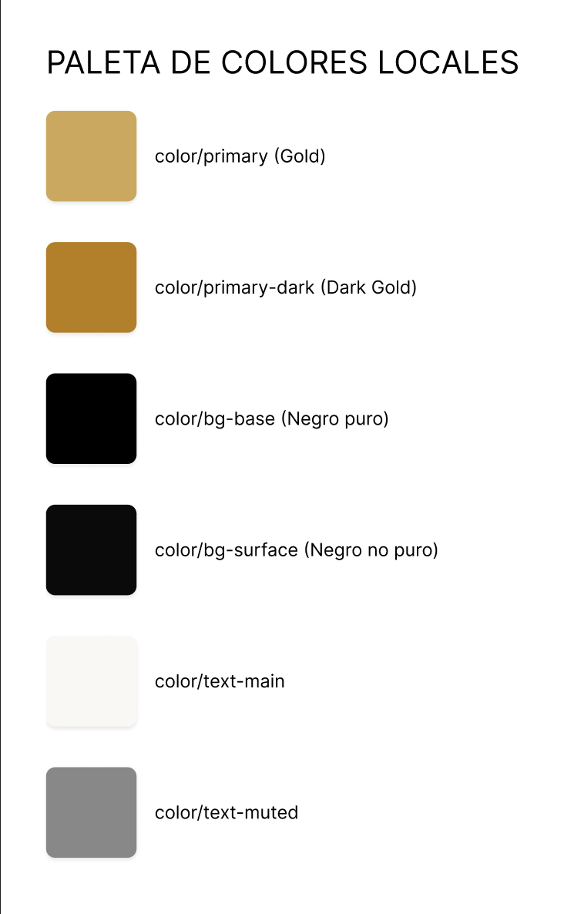
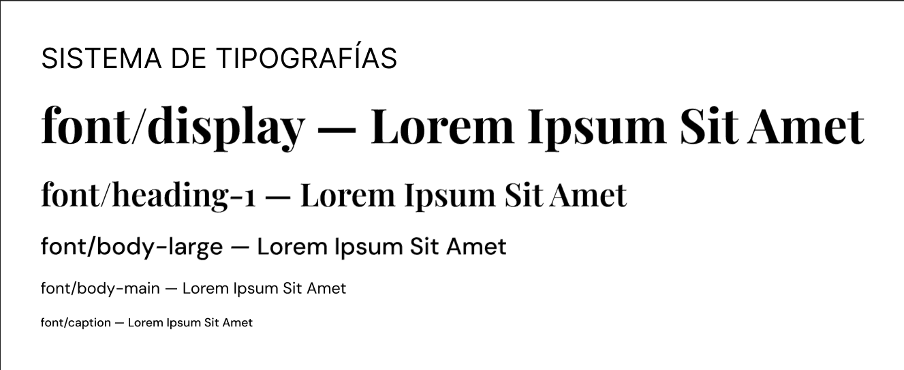
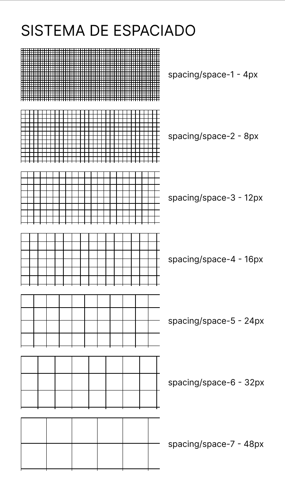
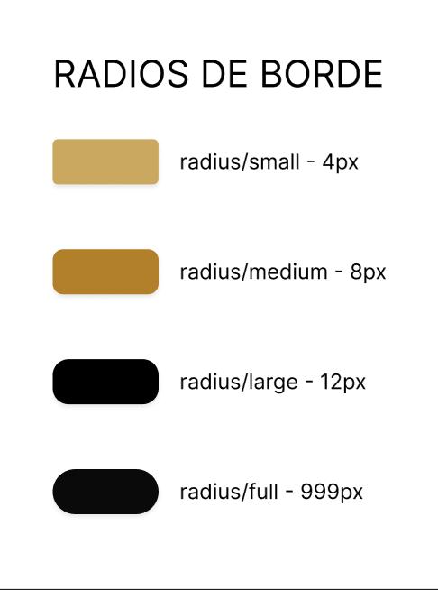
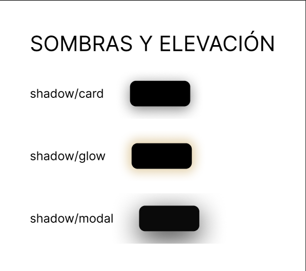
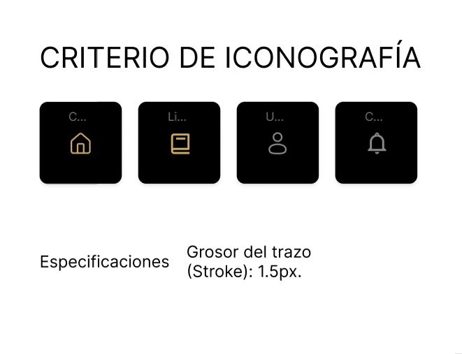
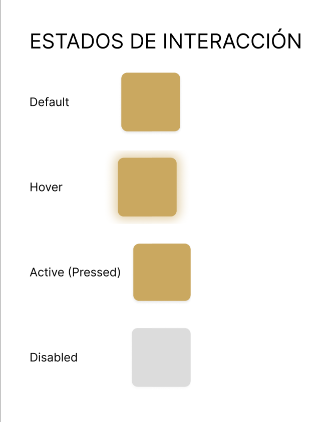
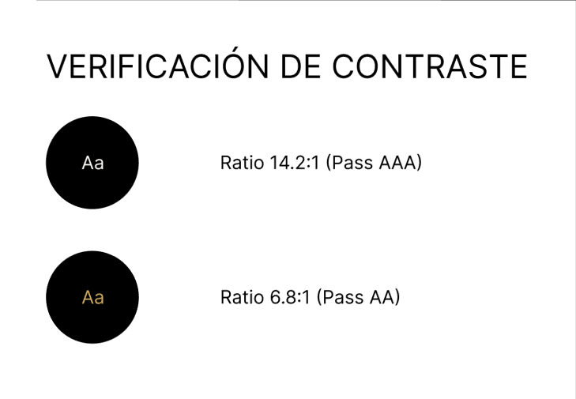

# Kontrol Design Tokens para Figma

## 1. Estructura de Tokens por Categoría

Todos los tokens siguen la estructura `category/token-name` en Figma Tokens.

### COLOR/

#### Primarios
- `color/primary`: #caa860 (Gold - Main brand)
- `color/primary-2`: #b27f2a (Gold - Active/Pressed)
- `color/secondary`: #886911 (Warm accent)

#### Superficies (Dark Mode)
- `color/bg`: rgba(0,0,0,0.92) (Full-page overlay)
- `color/bg-2`: #120f07 (Primary surface - cards, panels)
- `color/bg-3`: #282825 (Secondary depth layer)
- `color/tertiary`: #12120e (Darkened overlay)

#### Bordes
- `color/border`: #312713 (Subtle borders on dark)
- `color/pill-back`: #120f07 (Badge/pill backgrounds)

#### Texto Primario
- `color/text`: #faf8f5 (High-contrast on dark)

#### RGB Triplets (para transparencias)
- `color/primary-rgb`: 202, 168, 96
- `color/error-rgb`: 224, 82, 82
- `color/success-rgb`: 72, 199, 116
- `color/black-rgb`: 0, 0, 0
- `color/white-rgb`: 255, 255, 255

---

### TEXT/ (Rampa de Jerarquía)

Escala descendente de claridad para texto secundario:
- `text/soft`: #cfc9bf (Secundario alto - Labels principales)
- `text/muted`: #a0998d (Secundario - opciones no seleccionadas)
- `text/dim`: #9e9485 (Terciario - Metadata)
- `text/faint`: #988f7e (Muy tenue, pero legible - ayudas y pies)
- `text/placeholder`: #a18d6d (Placeholders en inputs, más cálido que un valor escrito)

Toda la rampa cumple WCAG AA (≥ 4.5:1) sobre `color/bg-3` (#282825), la superficie más clara en uso. Antes era muted #989083, dim #6e6558, faint #565045 y placeholder #4a4030 (hasta 1.5:1). Solo se subió la luminosidad: el tono y la saturación son los mismos. **Pendiente:** actualizar estos valores en el archivo de Figma.

Para controles deshabilitados existe un token de implementación aparte, `--k-text-disabled` (#565045), que no se usa para texto informativo.

---

### VISUALSTATES/

Estados semánticos:
- `visualStates/success-text`: #48c774 (Verde éxito)
- `visualStates/error-text`: #e46868 (Rojo error; antes #e05252, aclarado para mantener 4.5:1 sobre el fondo animado)

**Nota:** Success y Error backgrounds se usan en tags/badges:
- `color/success`: rgb(15, 77, 15)
- `color/error`: rgb(128, 13, 13)
- `color/warning`: rgb(120, 80, 10)

---

### FORMS/

Estilos específicos de formularios:
- `forms/input-bg`: rgba(ink-rgb, 0.04) (Input default; blanco al 4 % en oscuro)
- `forms/input-focus-bg`: rgba(202, 168, 96, 0.05) (Input focused)
- `forms/btn-text`: #0e0c08 (Texto sobre botones gold)

---

### TINTA Y LIENZO (siguen al tema)

`color/black-rgb` y `color/white-rgb` son literales. Para tintes que cambian con el tema:
- `color/ink-rgb`: 255, 255, 255 (claro: 0, 0, 0) — hovers y bordes sutiles
- `color/canvas-rgb`: 0, 0, 0 (claro: tono de la página) — velos y paneles translúcidos

---

### HUE/ (colores categóricos)

Estados, prioridades y gráficos. Cada uno tiene su triplet `-rgb`:
- `hue/rose`: #fb7185 (claro: #a8041d)
- `hue/blue`: #60a5fa (claro: #0550ac)
- `hue/emerald`: #34d399 (claro: #155f44)
- `hue/green`: #4ade80 (claro: #115f2e)
- `hue/violet`: #a78bfa (claro: #4c14f5)
- `hue/orange`: #fb923c (claro: #873e03)
- `hue/amber`: #f59e0b (claro: #744b05)

---

### SURFACE/ (superficies de implementación)

- `surface/scrim`: rgba(var(--k-canvas-rgb), 0.6) (claro: rgba(var(--k-canvas-rgb), 0.6))
- `surface/panel`: rgba(var(--k-canvas-rgb), 0.6) (claro: #d2cec6)
- `surface/section`: rgba(var(--k-color-black-rgb), 0.94) (claro: #d2cec6)
- `surface/card`: var(--k-color-bg-2) (claro: #d2cec6)
- `surface/chart`: var(--k-color-bg) (claro: var(--k-color-tertiary))
- `surface/warm`: #161310 (claro: #efebe3)
- `surface/warm-2`: #1f1a13 (claro: #e7e1d6)
- `surface/floating`: #0f0f0f (claro: #e2ddd3)
- `surface/floating-2`: #111111 (claro: #d9d3c7)
- `surface/floating-3`: #1a1a1a (claro: #d0c9bc)
- `surface/code`: #000000 (claro: rgba(0, 0, 0, 0.07))
- `surface/track`: #111111 (claro: #c2c2c2)
- `overlay/backdrop`: rgba(var(--k-color-black-rgb), 0.78) (claro: rgba(var(--k-color-black-rgb), 0.4))
- Grises agregados a la rampa: `shade/0` #050505, `shade/3b` #151515, `shade/6b` #252525

---

### CAPAS (z-index)

Escala única; ningún componente usa números sueltos:
- `z/negative`: -1
- `z/background`: 0
- `z/base`: 1
- `z/raised`: 2
- `z/top`: 3
- `z/sticky`: 10
- `z/elevated`: 20
- `z/popover`: 40
- `z/nav`: 100
- `z/dropdown`: 200
- `z/floating`: 500
- `z/modal-overlay`: 1000
- `z/modal`: 1001
- `z/overlay`: 1400
- `z/overlay-top`: 2000
- `z/system`: 10000

---

## 2. Tipografía

### FONT/

Familias tipográficas:
- `font/display`: "Playfair Display" (Serif - Títulos)
- `font/sans`: "Manrope" (Sans-serif - UI/Body)
- `font/mono`: "JetBrains Mono" (Monospace - Código/KPIs)

### FONTSIZE/

Escala tipográfica (en píxeles):
- `fontSize/display`: 42px (Títulos dashboard principales)
- `fontSize/heading-1`: 24px (Headers, card titles)
- `fontSize/body-large`: 16px (Body text - variante mayor)
- `fontSize/body-main`: 14px (Body text - default)
- `fontSize/caption`: 11px (Captions, pills, metadata)

### FONTWEIGHT/

Pesos disponibles (numéricos):
- `fontWeight/regular`: 400
- `fontWeight/medium`: 500
- `fontWeight/semibold`: 600
- `fontWeight/bold`: 700

### LINEHEIGHT/ y LETTERSPACING/

- `leading/tight`: 1.15 (Headings)
- `leading/snug`: 1.3 (Subheadings)
- `leading/normal`: 1.5 (Body text)
- `tracking/tight`: -0.01em (Headlines)
- `tracking/caps`: 0.08em (Uppercase labels/buttons)

---

## 3. Espaciado (8pt Grid)

### SPACING/

Todos los valores en píxeles (8pt base):
- `space/1`: 4px (Micro gaps)
- `space/2`: 8px (Tight padding - buttons)
- `space/3`: 12px (Field/label spacing)
- `space/4`: 16px (Component padding)
- `space/5`: 24px (Section spacing)
- `space/6`: 32px (Large sections)
- `space/7`: 48px (Major spacing - full-width)

---

## 4. Bordes (Radios)

### RADIUS/

Radios de borde (en píxeles):
- `radius/sm`: 4px (Buttons, small inputs)
- `radius/md`: 8px (Standard cards)
- `radius/lg`: 12px (Modals, large overlays)
- `radius/xl`: 24px (Feature cards)
- `radius/pill`: 999px (Badges, avatars, full-round)

---

## 5. Sombras

### SHADOW/

Efectos de profundidad (sintaxis CSS):
- `shadow/card`: `0 4px 20px 0 rgba(0, 0, 0, 0.5)` (Superficies)
- `shadow/glow`: `0 0 15px 5px rgba(202, 168, 96, 0.5)` (Hover interactivo)
- `shadow/modal`: `0 10px 40px 0 rgba(0, 0, 0, 0.8)` (Top-layer modals)
- `shadow/dropdown`: `0 8px 32px rgba(0, 0, 0, 0.6)` (Menús desplegables)

---

## 6. Estados de Interacción

### STATES/

Modificadores de estado (uso en CSS):
- `state/hover-brightness`: 1.15 → `filter: brightness(1.15)`
- `state/active-scale`: 0.98 → `transform: scale(0.98)`
- `state/disabled-opacity`: 0.3 → `opacity: 0.3`

### FOCUS/

Focus ring:
- `focus-ring-width`: 2px
- `focus-ring-offset`: 2px
- `focus-ring`: `2px solid #caa860`

---

## 7. Iconografía

- **Biblioteca:** Lucide Icons / Heroicons
- **Stroke Weight:** 1.5px (definido como `icon-stroke`)
- **Tamaño estándar:** 24px × 24px
- **Tamaños permitidos:** 24px, 32px, 40px (grid 8pt)
- **Color:** Hereda de `currentColor` (contexto de texto)

---

## 8. Documentación Externa

- Link al Figma file: `https://www.figma.com/design/qDDZC8ZvzDhXHRzDl6bbHi/Kontrol---Identidad-visual-v2?node-id=35-26&t=AQIBKGoAGr8AsFS7-1`
- Link a esta guía: `/frontend/docs/design-system.md`
- Link a tokens JSON: `/frontend/docs/tokens.json`
- Visualización: `./frontend/docs/assets/Kontrol_v2.png`

---

## 9. Referencia visual

> Esta guía acompaña la hoja de referencia visual del sistema y no sustituye la documentación técnica en [`design-system.md`](./design-system.md).

---

## 10. Tema claro (propuesta pendiente de validación de Diseño)

- Se elige en **Configuración → Tus preferencias → Tema**: Sistema, Oscuro o Claro. Sistema sigue `prefers-color-scheme`.
- La landing, el inicio de sesión y el registro son siempre oscuros.
- Derivación: superficies y rampa neutra con la luminosidad invertida y tonificadas a gris piedra; texto, dorado, estados y tonalidades con el mismo tono, oscurecidos hasta AA.

| Token | Valor claro | Contraste mínimo |
| :--- | :--- | :--- |
| `color-text` | #1a1712 | 10.79:1 |
| `color-primary` | #5e4a1f | 5.12:1 |
| `text-soft` | #403a30 | 6.8:1 |
| `text-muted` | #575249 | 4.68:1 |
| `text-dim` | #5a5247 | 4.64:1 |
| `text-faint` | #595347 | 4.61:1 |
| `text-placeholder` | #5e503c | 4.72:1 |
| `gray-3` | #535353 | 4.65:1 |
| `state-error-text` | #961a1a | 5.16:1 |
| `state-success-text` | #1c5e34 | 4.7:1 |
| `hue-blue` | #0550ac | 4.61:1 |
| `hue-emerald` | #155f44 | 4.61:1 |
| `hue-green` | #115f2e | 4.7:1 |
| `hue-violet` | #4c14f5 | 4.65:1 |
| `hue-orange` | #873e03 | 4.66:1 |
| `hue-amber` | #744b05 | 4.61:1 |
| `hue-rose` | #a8041d | 4.7:1 |

Superficies principales en claro: página `#dbd8d3`, tarjetas `#e4e4e4`, paneles `#d2cec6`, bordes `#c2c2c2`. Los valores completos están en el bloque `[data-theme='light']` de `src/styles/theme.css`.
